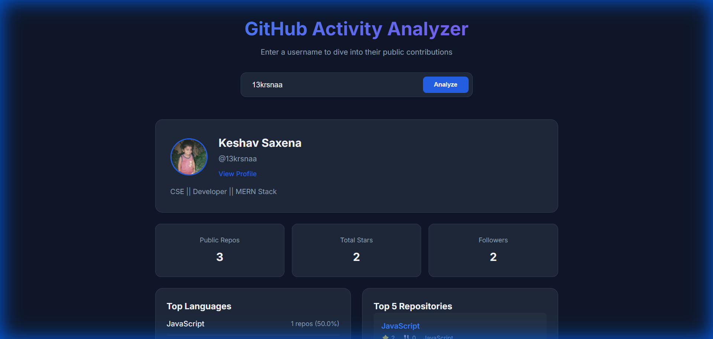

# Mini GitHub Activity Analyzer 🚀

A sleek, professional, and responsive dashboard to analyze GitHub user activity using the official GitHub REST API. Built with React for modern, component-based architecture.

## ✨ Features

- **Real-time Data Fetching**: Get instant insights using any GitHub username.
- **Activity Analytics**:
  - **Total Stars**: Aggregated across all public repositories.
  - **Language Profile**: Distribution of top languages used.
  - **Top Repositories**: Highlights the most starred projects.
- **Modern UI**: Dark-themed, glassmorphic design inspired by premium dashboards.
- **Responsive**: Perfect viewing experience across desktop, tablets, and mobile devices.
- **User Persistence**: Remembers your last search using LocalStorage.
- **React Architecture**: Clean component-based design with hooks and state management.

## 📸 Preview

Searching for [@13krsnaa](https://github.com/13krsnaa):



## 🛠️ Technology Stack

- **React 18**: Modern functional components with hooks
- **HTML5**: Semantic structure.
- **CSS3**: Custom properties (variables), Grid, and Flexbox.
- **JavaScript (ES6+)**: Fetch API, Async/Await, and modern React patterns.
- **GitHub API**: Public user and repository endpoints.

## 🚀 How to Run

1. Clone or download the project.
2. Install dependencies: `npm i`
3. Start development server: `npm start`
4. Open http://localhost:3000 in your browser.
5. Enter a GitHub username and click **Analyze**.

## 📁 Project Structure

```text
├── public/
│   └── index.html       # HTML template
├── src/
│   ├── components/      # React components
│   │   ├── SearchBar.jsx
│   │   ├── Loader.jsx
│   │   ├── ErrorState.jsx
│   │   ├── ProfileCard.jsx
│   │   ├── StatsGrid.jsx
│   │   ├── LanguageList.jsx
│   │   └── RepoList.jsx
│   ├── utils/
│   │   └── githubApi.js # API utilities and data processing
│   ├── App.jsx          # Main application component
│   ├── index.js         # React DOM entry point
│   └── style.css        # Premium styling and animations
├── package.json         # Dependencies and scripts
└── README.md           # Project documentation
```

## 🔄 Migration from Vanilla JS

This project has been converted from vanilla JavaScript to React with:
- Component-based architecture
- State management with React hooks
- Conditional rendering instead of DOM manipulation
- Parallel API calls with Promise.all
- Clean separation of concerns
- Interview-ready code structure

---

Built by @13krsnaa.
